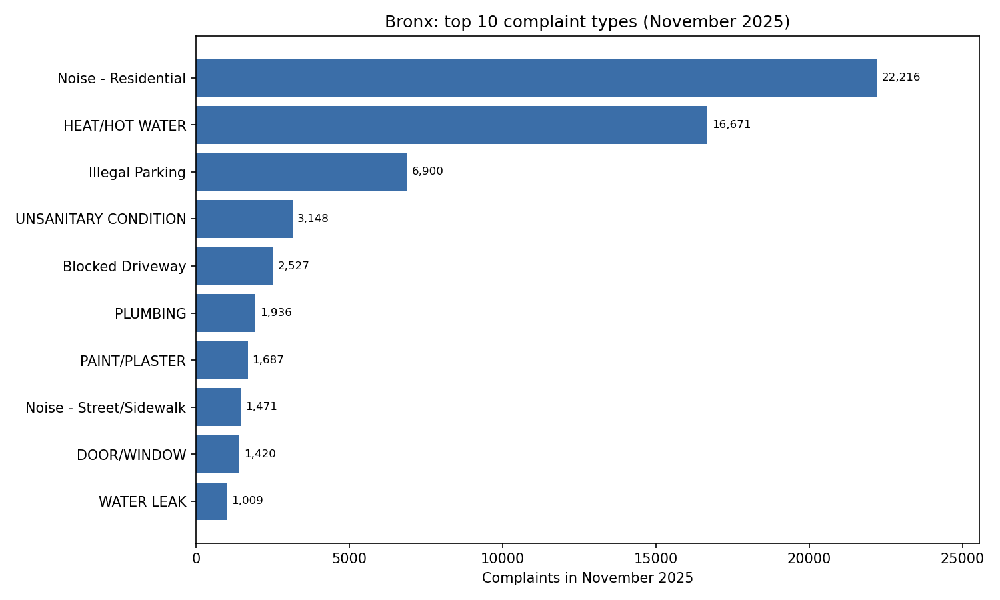
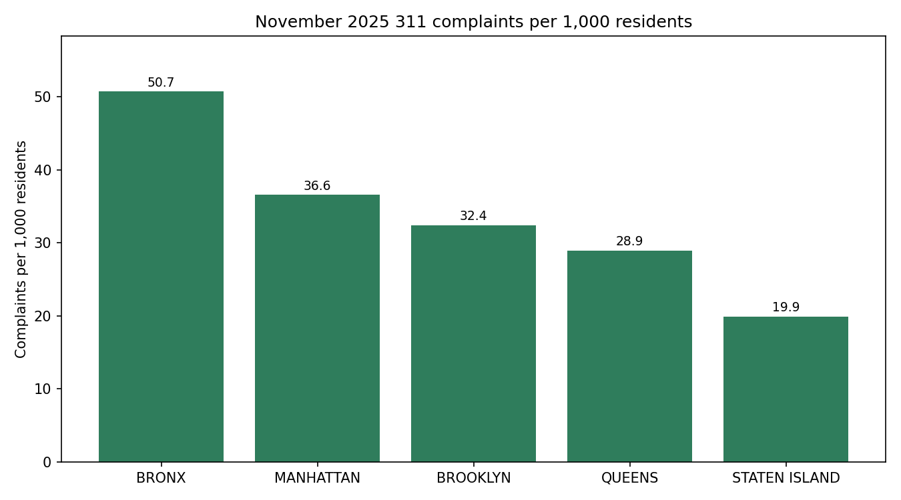
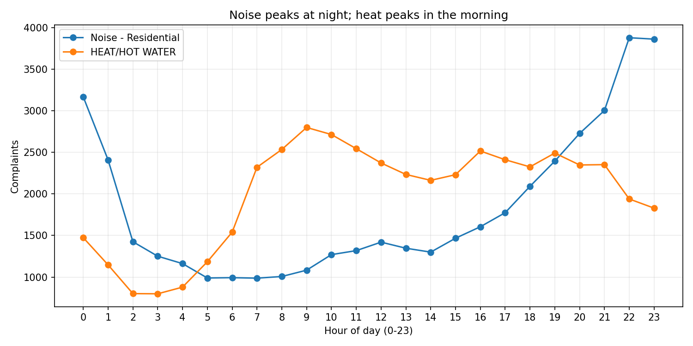
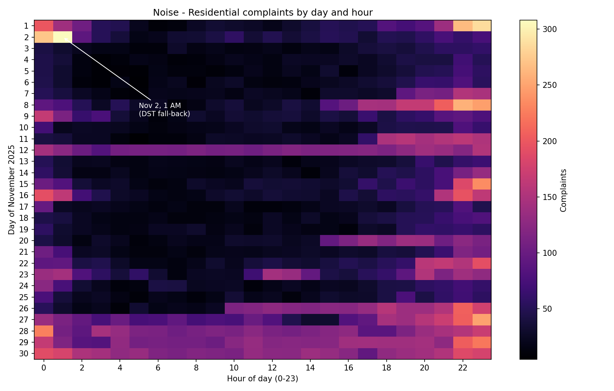
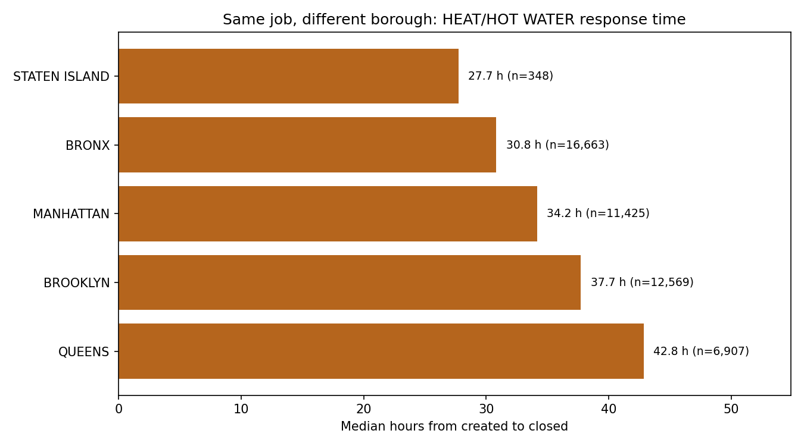

# CS 2010 Lab 11 — A Month of New York Complaining

**Team #1365:** Dakota Fowler, Justin Theberge Jr, Christian Dow  
**Date:** 16 November 2026  
**Data:** `nyc-311-2025-november.csv.gz` — 304,905 rows × 44 columns, New York City 311 service requests created 1–30 November 2025.  
**Code:** [`analysis.py`](analysis.py) · **Figures:** [`figures/`](figures/) · **Run:** `CENSUS_API_KEY=... python3 analysis.py`

The report follows the lab's working loop: ask, run, then verify with an
independent count. The second method for every headline number is in the
code and in the verification tables below. The data file is not committed;
`.gitignore` keeps `data/`, CSV files, and `.env` out of the repository.

---

## Task 1 — First look

The file has **304,905 rows and 44 columns** before the two parsed date
columns are added. There are **174 distinct problem types**. The first
created complaint is `2025-11-01 00:00:04` and the last is
`2025-11-30 23:59:52`.

**4,136 rows have no `Closed Date`.** Their status values are:

| Status | Rows |
| --- | ---: |
| In Progress | 3,402 |
| Open | 300 |
| Pending | 199 |
| Assigned | 168 |
| Started | 65 |
| Closed | 2 |

The two `Closed` rows with no close time are a small data-quality flag:
status and date disagree. They stay in the dropped/open group for Task 5.

### Verification — Task 1

| Number | Primary method | Second method | Same? |
| --- | --- | --- | --- |
| Rows × columns | `df.shape` → 304,905 × 44 | gzip line count minus header → 304,905 data rows | yes |
| Distinct problem types | `nunique()` → 174 | `len(set(...))` → 174 | yes |
| Earliest / latest created | pandas `to_datetime` → `2025-11-01 00:00:04` / `2025-11-30 23:59:52` | `datetime.strptime` on every raw string → same | yes |
| No `Closed Date` | `isna()` → 4,136 | blank-string filter → 4,136 | yes |

Two ways are left as comments in `analysis.py` (`line_count`, the
`datetime.strptime` list, and the blank-string filter).

---

## Task 2 — A borough's profile: the Bronx

The Bronx filed **74,674** complaints in November. Its raw top five:

| Rank | Complaint type | Count | Share of Bronx |
| ---: | --- | ---: | ---: |
| 1 | Noise - Residential | 22,216 | 29.75% |
| 2 | HEAT/HOT WATER | 16,671 | 22.33% |
| 3 | Illegal Parking | 6,900 | 9.24% |
| 4 | UNSANITARY CONDITION | 3,148 | 4.22% |
| 5 | Blocked Driveway | 2,527 | 3.38% |

### The address trap

That #1 is almost a single-address story. **655 EAST 230 STREET** alone has
**14,362** complaints, and **14,361** of them are `Noise - Residential` —
**64.6%** of the Bronx's noise calls. Remove that one address and the
borough's profile flips:

| Rank after removing 655 E 230 St | Complaint type | Count | Share of 60,312 |
| ---: | --- | ---: | ---: |
| 1 | HEAT/HOT WATER | 16,671 | 27.64% |
| 2 | Noise - Residential | 7,855 | 13.02% |
| 3 | Illegal Parking | 6,900 | 11.44% |
| 4 | UNSANITARY CONDITION | 3,148 | 5.22% |
| 5 | Blocked Driveway | 2,527 | 4.19% |

This is the lecture's warning in concrete form: counts measure **calls**,
not **people**. One address (or one forwarding service) can dominate a
category, so "the Bronx's biggest problem is noise" is not a safe sentence
without the address caveat.

### Brooklyn as the comparison

Brooklyn filed **88,591** complaints. Its top five are a different shape:

| Rank | Complaint type | Count | Share of Brooklyn |
| ---: | --- | ---: | ---: |
| 1 | Illegal Parking | 18,460 | 20.84% |
| 2 | HEAT/HOT WATER | 12,582 | 14.20% |
| 3 | Noise - Residential | 9,075 | 10.24% |
| 4 | Blocked Driveway | 6,061 | 6.84% |
| 5 | UNSANITARY CONDITION | 2,990 | 3.38% |

Brooklyn's parking share is more than twice the Bronx's (20.84% vs.
9.24%), while the Bronx's heat share is higher (22.33% vs. 14.20%). A
plausible **hypothesis** is that Brooklyn's denser mixed-use street grid
and curbside parking produce more parking complaints, while the Bronx's
large multifamily buildings produce more heat and noise calls. That is a
hypothesis about land use and housing stock, not a fact this file can
prove. It also still counts calls, not residents.



**Verification:** the five counts are the top of a single `value_counts()`;
their sum equals the borough total (74,674) when all categories are
included, and the shares are count ÷ 74,674. The address share is
14,361 ÷ 22,216 = 64.64%.

---

## Task 3 — Apples to apples: complaints per 1,000 residents

The five boroughs are five counties. The 2020 Census PL totals
(`P1_001N`, `state:36`) are:

| Borough | County / FIPS | Population (2020) |
| --- | --- | ---: |
| Bronx | Bronx County / 36005 | 1,472,654 |
| Brooklyn | Kings County / 36047 | 2,736,074 |
| Manhattan | New York County / 36061 | 1,694,251 |
| Queens | Queens County / 36081 | 2,405,464 |
| Staten Island | Richmond County / 36085 | 495,747 |

The five add to **8,804,190**, which passes the ~8.8 million sanity check.
The API call is in `fetch_populations()` and reads the key from
`CENSUS_API_KEY`; if the key is missing or the API returns its HTML error
page, the script falls back to these published totals and says so. No key is
stored in the repository. The **196** rows with `Borough == "Unspecified"`
are set aside because they have no population to normalize against.

| Borough | Population | Complaints | Complaints per 1,000 |
| --- | ---: | ---: | ---: |
| Bronx | 1,472,654 | 74,674 | **50.71** |
| Manhattan | 1,694,251 | 61,956 | **36.57** |
| Brooklyn | 2,736,074 | 88,591 | **32.38** |
| Queens | 2,405,464 | 69,617 | **28.94** |
| Staten Island | 495,747 | 9,871 | **19.91** |

**Raw rank:** Brooklyn, Bronx, Queens, Manhattan, Staten Island.  
**Per-1,000 rank:** Bronx, Manhattan, Brooklyn, Queens, Staten Island.

Two ranks change. Brooklyn falls from #1 to #3 because it is the most
populous borough (2.74 M), so its large raw count is flattered by the
denominator. Manhattan rises from #4 to #2: it has fewer residents than
Brooklyn but many daytime workers and visitors who can file, and its
complaint rate is high on a smaller residential base. The Bronx rises from
#2 to #1. This still measures calls, not complainers; the address trap from
Task 2 can move a borough rate too.



**Verification:** the Bronx is recomputed by plain calculator:
74,674 ÷ 1,472,654 × 1,000 = **50.7071**, matching the table. The
population sum is checked against 8.8 million, and the API response is
checked for `application/json` before it is parsed.

---

## Task 4 — Night and day

The two problem types have opposite daily rhythms:

- **Noise - Residential** peaks at **22:00** with **3,878** calls.
- **HEAT/HOT WATER** peaks at **09:00** with **2,799** calls.

The claim survives a borough split. In **Brooklyn**, noise still peaks at
**22:00** (910 calls) and heat still peaks at **09:00** (845 calls). The
curves are not mirror images — heat is broad from 07:00 to 19:00, while
noise climbs after 18:00 and falls sharply after midnight — but the peak
hours are stable.



### The night that is not like the others

The day × hour heat map is mostly the same shape every night: a bright
band at 21:00–23:00 and a dark band at 03:00–06:00. The exception is
**2 November at 01:00**, with **308** noise calls, roughly double the other
Sundays (113, 163, 144, 181). At 02:00 the count is only 91.

The likely cause is the end of daylight saving time. Clocks fell back from
02:00 to 01:00 on 2 November 2025, so the 01:00–01:59 wall-clock hour
occurred twice; the file stores local wall-clock text without a UTC offset,
so both passes land in hour 1. Two checks rule out the boring explanations.
First, the file has **zero duplicate `Unique Key`s** and **zero exact
duplicate rows**, and the 308 rows at that hour have **308 distinct keys**.
Second, those rows are spread across **248 distinct addresses** (the top
address has only 10), so this is not one address bursting. The extra volume
is a clock artifact, not duplicated or fabricated rows.



**Verification:** the plotted peak (22:00) matches both
`value_counts().idxmax()` and `np.bincount(...).argmax()`; both give 3,878.
The heat peak (09:00, 2,799) matches the same two methods. The Sunday
comparison is printed by the script, and the duplicate/unique-key checks
are in `task4_night_and_day()`.

---

## Task 5 — Response times

The file has **300,769 closed cases** and **4,136 rows with no close time**.
The open rows are dropped explicitly, so the medians are over closed cases
only. The six busiest agencies:

| Agency | Total complaints | Closed used | Open dropped | Median hours to close |
| --- | ---: | ---: | ---: | ---: |
| NYPD | 139,819 | 139,819 | 0 | 1.25 |
| DSNY | 20,363 | 20,150 | 213 | 38.55 |
| DEP | 13,734 | 13,608 | 126 | 39.58 |
| HPD | 86,247 | 86,032 | 215 | 53.84 |
| DOT | 14,516 | 14,148 | 368 | 82.84 |
| DOB | 8,318 | 8,318 | 0 | 182.54 |

The longest single complaint created in November is **Unique Key
66705910**, an **Overgrown Tree/Branches** complaint in **Brooklyn**,
handled by **DPR**:

- Created: `11/02/2025 03:35:44 PM`
- Closed: `11/12/2026 11:18:34 AM`
- Elapsed: **8,995.7 hours = 374.8 days**

For DPR, the mean is **917.5 h** but the median is **186.7 h**. The gap is
a long right tail, not one bad row: the 75th percentile is 1,008 h, the
90th is 3,137 h, **1,655** cases took over 30 days, and **727** took over
90 days. The single longest case adds only 1.65 h to the mean by itself.
So the mean describes the slow tail of multi-week/seasonal tree work, while
the median describes the typical DPR case. The mean-vs-median gap is a
statement about the shape of the distribution.

**Verification:** every agency median is recomputed with `numpy.median` on
the plain array; the maximum difference from the pandas `groupby` median is
`0.0000000000` h. The longest case is found by `idxmax()` on the elapsed
hours and checked against the sorted head of the frame.

---

## Task 6 — Hold the job fixed: HEAT/HOT WATER by borough

`HEAT/HOT WATER` is the clean test: **47,946** rows, every one answered by
HPD, and large in all five boroughs. After dropping the **34** open cases,
the closed cases are:

| Borough | Closed HEAT cases | Median hours to close |
| --- | ---: | ---: |
| Staten Island | 348 | **27.74** |
| Bronx | 16,663 | **30.82** |
| Manhattan | 11,425 | **34.16** |
| Brooklyn | 12,569 | **37.73** |
| Queens | 6,907 | **42.84** |

The fastest and slowest boroughs differ by **15.10 hours**, or **54.4%**
of the fastest median. The "different jobs" excuse is no longer available:
this is the same complaint type, the same agency, and the same November
file. The remaining candidates are place and process — building age and
heating-plant type, landlord responsiveness, HPD inspection scheduling and
staffing by borough, the mix of large buildings and repeat callers, and
administrative closure practice. To tell those apart I would need
building-level records (the file's BBL could link to them), HPD inspection
and closure logs, and caller/building identifiers to see whether Queens'
slower median is a few large buildings or a broad slowdown. This file alone
can measure the gap; it cannot explain it.



**Verification:** the Bronx median is recomputed with
`statistics.median` on a plain Python list: **30.815000 h**, exactly the
`groupby` value. The open-case filter is visible in `task6_same_job()` and
the count dropped (34) is stated above.

---

## Task 7 — Data detective: one address in Fresh Meadows

The lecture already used 655 East 230 Street, so this is a different
anomaly. **78-15 Parsons Boulevard** in Fresh Meadows, Queens (ZIP 11366)
has **728 complaints** in November — the second-highest address count in
the file. All 728 sit at one coordinate, `(40.721959, -73.809697)`, and
they appear on all 30 days. The top problem types are:

| Problem type | Count |
| --- | ---: |
| Noise - Vehicle | 303 |
| Drug Activity | 77 |
| Noise - Residential | 72 |
| Noise | 72 |
| Noise - House of Worship | 67 |
| Traffic | 64 |
| Illegal Parking | 46 |
| Noise - Helicopter | 23 |

The descriptors are dominated by **Car/Truck Horn** (261), plus
**Use Outside** (77), **Noise: Alarms (NR3)** (72), **Loud Talking** (71),
**Loud Music/Party** (68), and **Chronic Stoplight Violation** (35).
NYPD handled 629 of the 728; the rest are DEP (76) and EDC (23). Status is
705 Closed and 23 In Progress. The hourly shape peaks at **09:00 (117)**
and **11:00 (110)**, i.e. daytime.

**The three queries:**

1. `value_counts()` on `Incident Address` put Parsons at #2 (728), behind
   only the lecture's 655 East 230 Street (14,362).
2. Filtering that address and grouping by `Problem (formerly Complaint
   Type)`, descriptor, and agency produced the noise/vehicle, drug, and
   house-of-worship mix above, with NYPD as the main responder.
3. Grouping by day and hour, and checking identifiers, showed 728 unique
   keys, activity on every day, a daytime peak, and one coordinate.

**Verdict (five sentences):** The concentration is real in the file, not a
duplicate-row artifact. It looks like a persistent noisy
commercial/residential corner — horns, drug activity, loud talking/music, a
house of worship — rather than one random burst. But the file has no
complainant ID, so a single resident filing hundreds of reports would look
identical to a genuine hotspot. The daytime peak fits a
street/transportation hotspot more than late-night party noise, which is
weak evidence for the hotspot story but not proof. The honest verdict is
"cannot tell from this file alone"; I would need 311 caller records, a site
visit, or NYPD/DEP enforcement logs to separate a real hotspot from a
coordinated complainant.

**Verification:** the address count is `len(sub)` after an exact string
filter and is checked against `value_counts()`; the unique-key count is
`nunique()` and is checked against `len(sub)`; the coordinate count is a
`drop_duplicates()` on the two coordinate columns (one row).

---

## LLM use

We used OpenCode (DeepSeek V4.1) as the coding assistant. We asked it to
inspect the columns, write the pandas code, generate the figures, and draft
the prose. It got several things wrong in the first pass, and each was
caught by a check:

- It assumed a `Complaint Type` column. The real column is
  `Problem (formerly Complaint Type)`; printing `df.columns` caught it.
- It assumed pandas would infer `Created Date` as a datetime. The column
  arrives as text (`11/30/2025 11:59:52 PM`), so we parsed it with the
  explicit `%m/%d/%Y %I:%M:%S %p` format and checked `dtype`, `min`, and
  `max`. A text-sorted chart would have put 9 AM after 11 PM.
- It first called the Census API without a key and got an HTML "Missing
  Key" page instead of JSON. Checking the response `Content-Type` caught
  it; the key now comes from `CENSUS_API_KEY` and is never committed.
- It initially included open cases in the agency medians. Filtering
  `Closed Date` explicitly and reporting the 4,136 dropped rows caught it.

Every headline number is recomputed a second way in `analysis.py`, and the
two-way comments are left in the code. No API key or data file is in this
repository.

---

## Reproduce

```bash
mkdir -p data
curl -o data/nyc-311-2025-november.csv.gz \
  https://files.homework.quest/cs2010/nyc-311-2025-november.csv.gz
python3 -m pip install -r requirements.txt
CENSUS_API_KEY=your_key_here python3 analysis.py
```

The script prints every number used above and writes the five figures into
`figures/`.
